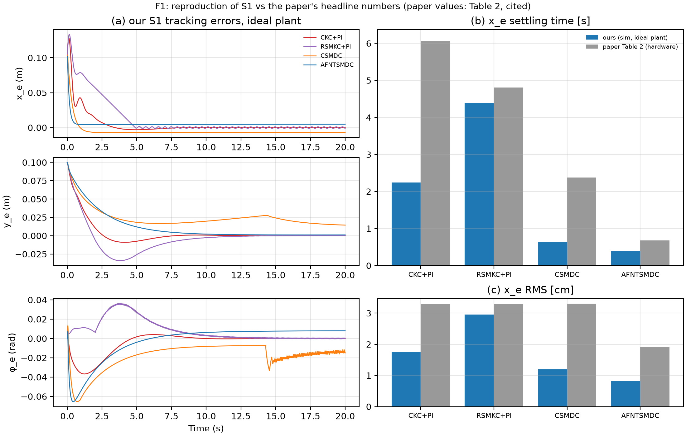
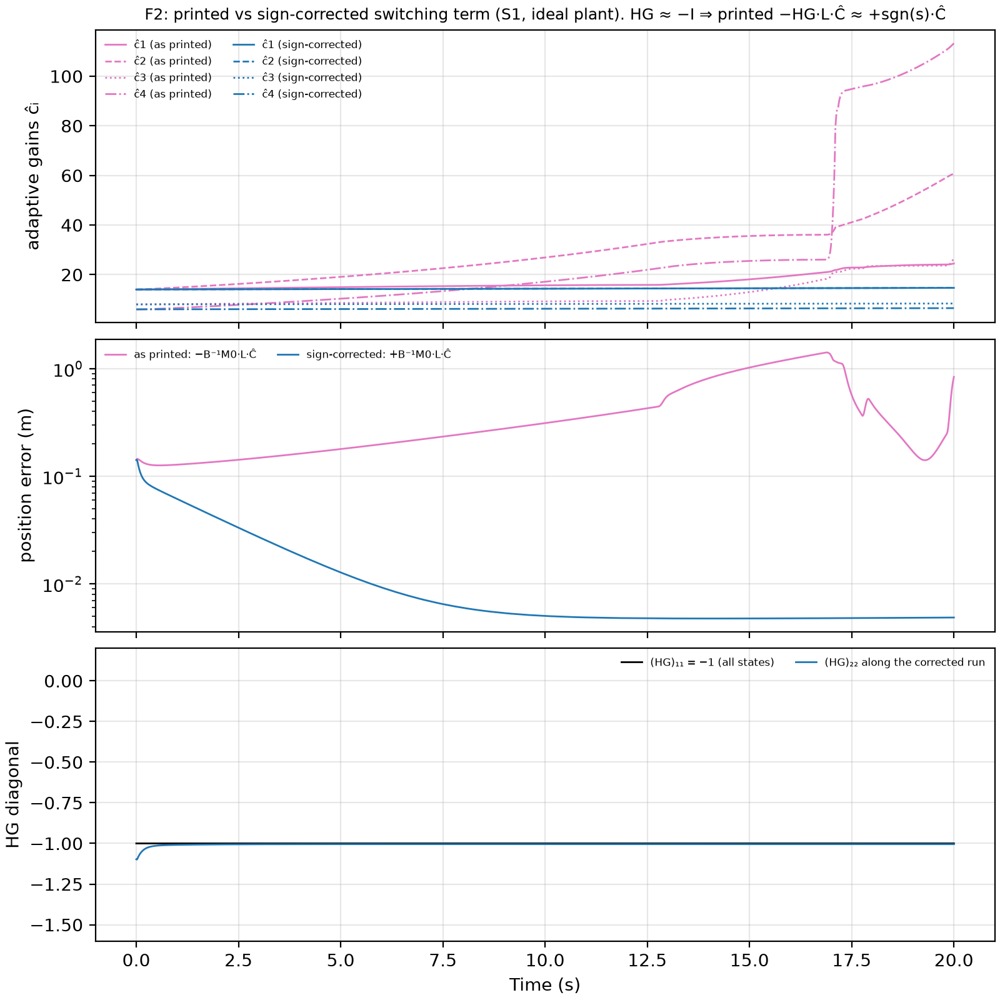
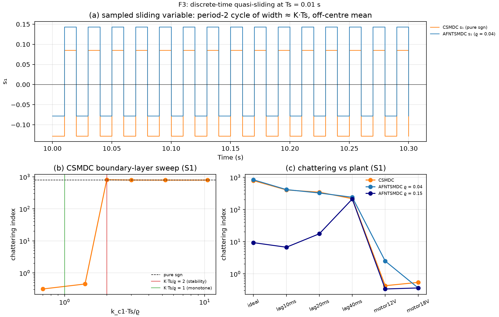
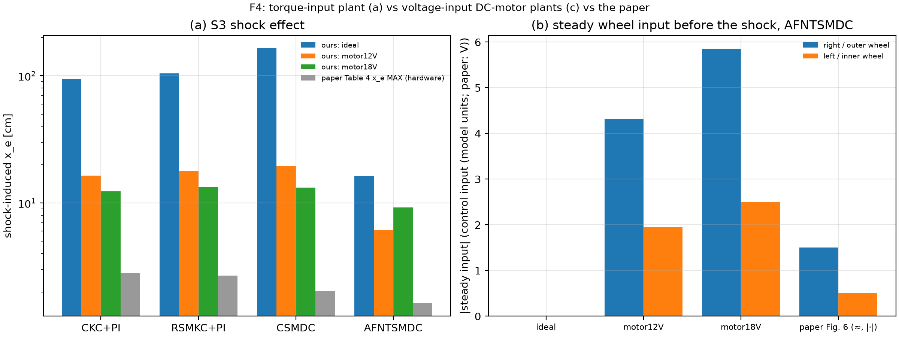
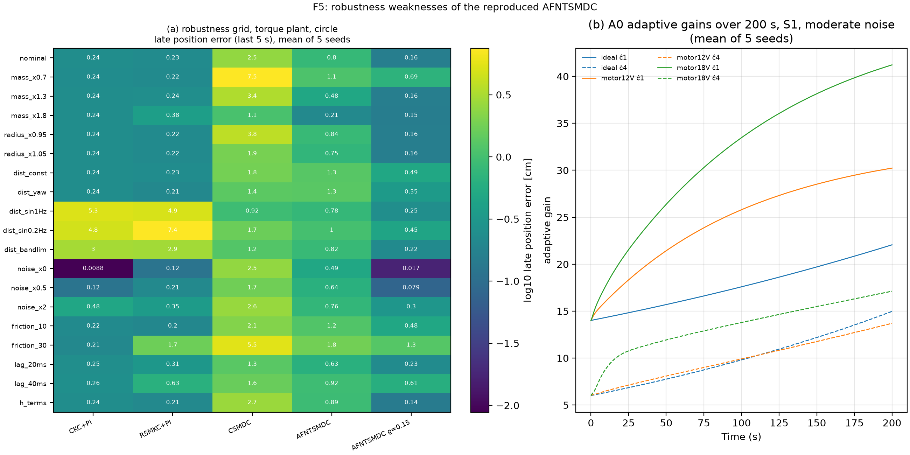
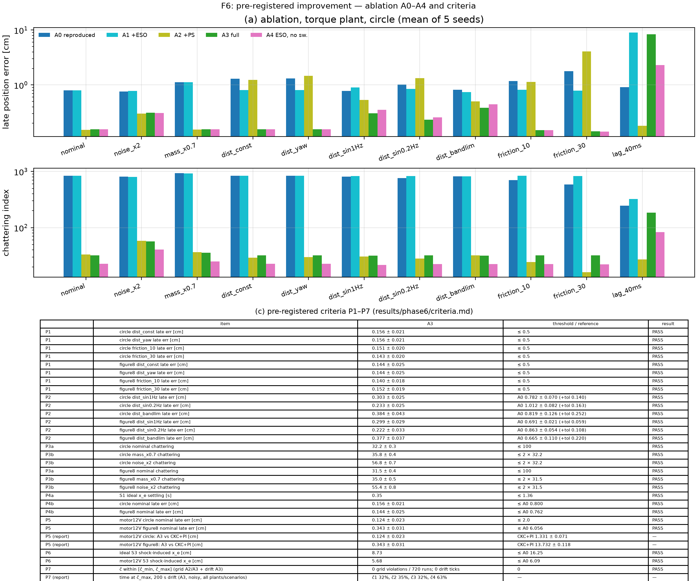
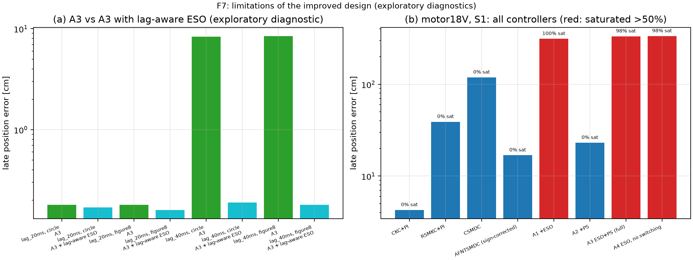

# Robust Finite-Time Trajectory Tracking of a Differential-Drive Robot: a Reproduction, Diagnosis and Pre-Registered Improvement of AFNTSMDC

**EEE F422 Modern Control Systems — Term Project.** BITS Pilani, Hyderabad Campus. Instructor: Prof. Joyjit Mukherjee.
**Author:** Devansh Sharma. **Repository:** `github.com/DevanshSharma867/mcs-ddmr-tracking` (private).

> **Traceability.** Every number in this report is taken from `results/report/key_numbers.csv`, which is
> generated by `python -m experiments.report_figures`. Every figure is in `results/report/`. Every
> claim has an entry in `docs/paper/claims.md` (IDs Cn below) with its evidence file and strength.
> `python -m experiments.run_all` regenerates everything from scratch on a laptop CPU.
> Evidence tiers (confirmatory / pre-specified / exploratory) are listed in `docs/paper/evidence_tiers.md`.
> Section ↔ grading criteria: `docs/report/grading_map.md`.

---

## Abstract
We reproduce, in simulation, the adaptive fast nonsingular terminal sliding-mode dynamic controller
(AFNTSMDC) of Xie et al. [1] for trajectory tracking of a differential-drive wheeled mobile robot, together with its
three baselines.

*Reproduction.* The reproduction matches the paper's headline qualitatively but not quantitatively.

*Inconsistency in the printed law.*
- With the printed equations, the adaptive switching term of the control law has the destabilising
  sign: near the origin HG = −I, and the term adds +sgn(s)·Ĉ to ṡ.
- We verify this symbolically, by an independent blind derivation and under seven alternative readings
  of the paper (plus an analytic check of one more convention).
- We present it as an inconsistency between the printed equations, compatible with either a sign slip
  or a different error convention.

*Two further weaknesses.*
- At the paper's sampling time (Ts = 0.01 s), the boundary layer is too thin for the switching gain,
  which produces discrete quasi-sliding chattering and a steady offset.
- A robustness study on two plant models shows no integral action against structured disturbances, and
  adaptive gains that grow without bound.

*Improvement.* We pre-registered an improvement: an extended state observer, projection of the
adaptive gains, and a boundary layer sized from the sampling time.
- It passes all 28 pre-registered checks.
- An ablation shows the adaptive switching term is largely redundant once the observer is present.
- Two exploratory diagnostics locate its limitations: sensitivity to actuator lag, and saturation under a
  large input-gain deficit.

---

## 1. Problem and model

### 1.1 The tracking problem
A differential-drive robot has two independently driven wheels on a common axle and passive casters.
Its pose is p = [x, y, φ]ᵀ (axle midpoint, heading). Its body velocities are z = [v, ω]ᵀ.

Because the wheels cannot slip sideways, the robot satisfies the **nonholonomic constraint**
ẋ·sin φ − ẏ·cos φ = 0. This restricts the velocities, not the reachable poses, so the pose can be steered
anywhere but not in every direction instantaneously. The constraint gives the kinematics

ẋ = v cos φ, ẏ = v sin φ, φ̇ = ω.

By Brockett's condition, no smooth static state feedback can stabilise a fixed pose. **Tracking** a moving
reference with v_r > 0 is tractable, which is the case studied here.

### 1.2 Dynamics
Reducing the Lagrangian model with the constraint gives the paper's reduced dynamics

M·ż = B·τ + d,  M = diag(m, I),  B = (1/r)·[[1, 1], [b, −b]],

where τ = [τ_R, τ_L] are the wheel inputs, r is the wheel radius, b is half the track width, and d is a
lumped disturbance.

The controller is designed with nominal M0 = diag(m0, I0). Everything else, including mass mismatch,
friction, disturbances and (on the motor plant) back-EMF, is lumped into an uncertainty δ, bounded by
|δ₁/m0| < c₁ + c₃|v| and |δ₂/I0| < c₂ + c₄|ω|. The parameters are m0 = 4.5 kg, I0 = 0.56 kg·m², r = 0.042 m,
b = 0.186 m, Ts = 0.01 s (Appendix B).

A full derivation (our §A.1 note) also produces Coriolis-type terms in the mass-centre offset h. They are
equivalent to the Fierro–Lewis form [5] with the mass centre behind the axle. They are omitted in the
paper's model and in our reproduction plant, but kept as an option.

### 1.3 Tracking error
The error is expressed in the robot frame:

pₑ = [xₑ, yₑ, φₑ]ᵀ = R(φ)ᵀ·(p_r − p),

with error dynamics ṗₑ = F + G·z, where F = [v_r cos φₑ, v_r sin φₑ, ω_r]ᵀ and G = [[−1, yₑ], [0, −xₑ], [0, −1]].
We verified symbolically that this G follows from the definition of pₑ (claim C4).

---

## 2. Literature
- **Kinematic tracking.**
  - Kanayama et al. [2] gave the classical Lyapunov-stable kinematic tracking law, the *CKC* baseline:
    v_d = v_r cos φₑ + k₁xₑ, ω_d = ω_r + k₂v_r yₑ + k₃v_r sin φₑ.
  - Kinematic controllers assume the commanded velocities are realised exactly. In practice an inner
    velocity loop (here a PI loop) must provide them.
  - Fierro and Lewis [5] showed how to "backstep" a kinematic law into the dynamics.
- **Sliding-mode control (SMC).**
  - Utkin's survey [3] established the variable-structure framework. A sliding surface s(x) = 0 is made
    attractive by a discontinuous term; once on it, the closed loop is insensitive to matched
    uncertainty.
  - Its known costs are chattering, caused by the discontinuity together with sampling and unmodelled
    actuator dynamics, and in discrete time the loss of ideal sliding. Gao, Wang and Homaifa [9] analysed
    this "quasi-sliding" behaviour.
  - Slotine and Li [11] popularised the boundary layer (replacing sgn by sat), trading exact sliding for
    smoothness.
- **Sliding-mode controllers for this robot.**
  - The *RSMKC* baseline is the robust sliding-mode kinematic controller of Nath et al. [4], used here
    with a PI inner loop.
  - The *CSMDC* baseline is a conventional sliding-mode dynamic controller defined in [1]. It uses the same
    unified structure as AFNTSMDC with a linear surface and a pure sgn reaching law.
  - **Terminal** SMC adds fractional powers to the surface so that the error reaches zero in finite time.
    The "nonsingular" and "fast" variants avoid negative fractional powers in the control law and speed
    up convergence far from the origin.
  - AFNTSMDC [1] combines such a surface with an adaptive estimate of the uncertainty bound.
- **Active disturbance rejection.**
  - Han's ADRC [6] estimates the total disturbance with an *extended state observer* (ESO) and cancels it.
  - Gao [7] introduced the bandwidth parameterisation (observer gains 2ω_o and ω_o²) used here.
  - Guo and Zhao [8] proved that the ESO error is bounded, of order 1/ω_o.
- **Adaptive control.** Projection of adaptive parameters onto a known box, with bounded estimates by
  construction, is standard [10].
- **Prior art for our improvement.** **ESO combined with adaptive SMC for a differential-drive robot
  already exists** (Cui et al. [12], cited by [1] itself). Our contribution is therefore not a new
  controller structure. It is a diagnosis of the published law and a pre-registered, ablated evaluation
  (§7).

---

## 3. The paper's method (AFNTSMDC)
AFNTSMDC [1] is a *unified* controller. Unlike the cascaded CKC+PI and RSMKC+PI, it maps pose and
velocity errors directly to wheel inputs, without assuming perfect velocity tracking.

1. **Tracking-error function.**
   ξ = [xₑ, φₑ + ρ/(|xₑ|+ρ)·atan(yₑ)]ᵀ with 0 < ρ < 1, and ξ̇ = H·ṗₑ.
   Driving ξ to zero forces xₑ = 0 and φₑ = −atan(yₑ). On that manifold the kinematics give
   ẏₑ = −v_r·yₑ/√(1+yₑ²), so yₑ → 0 when v_r > 0.
2. **Fast nonsingular terminal surface.** s = ξ̇ + αξ + β·sig(ξ)^γ, with sig(x)^a = |x|^a·sgn(x) and
   1 < γ < 2. Because γ > 1, its derivative contains |ξ|^(γ−1), which is bounded at ξ = 0. This is the
   "nonsingular" property.
3. **Control law.** τ = τ_eq + τ_r.
   - τ_eq cancels the nominal dynamics of ṡ. It requires inverting D = H·G·M0⁻¹·B, which the paper shows
     is never singular for 0 < ρ < 1.
   - τ_r = −D⁻¹(K₁s + K₂·sig(s)^μ) − B⁻¹M0·L·Ĉ, where L = diag(sgn sᵢ) (replaced in practice by a
     saturation of width ϱ = 0.04) and Ĉ = [ĉ₁ + ĉ₃|v|, ĉ₂ + ĉ₄|ω|] is the adaptive uncertainty bound.
4. **Adaptive law.** ĉ̇₁ = ζ₁|s₁|, ĉ̇₃ = ζ₃|v||s₁|, and similarly for ĉ₂ and ĉ₄. A dead zone |sᵢ| ≤ ε = 0.05
   freezes adaptation.
5. **Claims.** The paper claims finite-time convergence via a Lyapunov argument (sketched with its gaps in
   Appendix C), and validates the controller with hardware experiments on a circle (radius 0.6 m,
   0.7 rad/s) in three scenarios:
   - S1: initial offset (−0.1, −0.1, 0);
   - S2: a 3.6 kg payload;
   - S3: S2 plus a 6 V, 0.5 s half-sine shock.

---

## 4. Reproduction

### 4.1 Set-up
- **Simulator:** Python, fixed-step RK4 at 1 ms, controllers sampled at the paper's Ts = 0.01 s with
  zero-order hold. The simulator is deterministic; noise seeds are fixed in configs.
- **Assumptions:** every value the paper does not give is marked ASSUMED in a config file and in the
  assumption registry (Appendix A, `docs/reproduction_log.md`). The most consequential ones:
  - The paper's input "V" is treated as the generalised input of the model (M1).
  - Saturation at ±8 per wheel, read off the paper's plots (M2).
  - The PI inner loop outputs a generalised force/torque mapped to the wheels through B⁻¹ (M12). The
    literal "u₁ → right, u₂ → left" mapping is unstable in model units.
  - The reference circle's centre and start, read from the paper's figures.
- **Paper gains:** all gains are the paper's (Appendix B). Nothing was tuned to match the paper's curves.

### 4.2 Verdict
F1 compares our S1 runs on the torque-input plant with the paper's Table 2 (Figure F1).



*F1 — (a) our S1 tracking errors; (b) xₑ settling time and (c) xₑ RMS, ours vs the paper's Table 2
(hardware).*

| | x_e RMS ours / paper [cm] | x_e settling ours / paper [s] |
|---|---|---|
| CKC+PI | 1.75 / 3.30 | 2.24 / 6.07 |
| RSMKC+PI | 2.95 / 3.29 | 4.39 / 4.81 |
| CSMDC | 1.20 / 3.30 | 0.64 / 2.38 |
| AFNTSMDC (sign-corrected, §5) | 0.82 / 1.92 | 0.40 / 0.68 |

- **What matches (C1, C2).**
  - AFNTSMDC has the fastest xₑ convergence and the lowest xₑ RMS of the four, as in the paper.
  - CKC has the lowest yₑ and φₑ RMS in both (ours 1.66 cm / 0.0117 rad).
  - RSMKC+PI reproduces the paper's characteristic linear xₑ ramp, the sliding phase at its constant
    switching rate.
- **What does not match.**
  - x_e RMS values are 1.1–2.8× smaller than the paper's, as expected without noise, quantisation or
    friction.
  - Our CKC+PI settles about 2.7× faster than the paper's (C3).
  - CSMDC keeps a steady xₑ offset of −0.73 cm, and its yₑ never settles (explained in §6).
  - The paper's early transient spikes are absent.
- **Conclusion:** the reproduction is **qualitative, not quantitative**. Because the paper reports
  hardware measurements, this is the best a simulation reproduction can claim.

---

## 5. A sign inconsistency in the printed control law
When implemented exactly as printed, AFNTSMDC **diverges**. In S1 the late position error reaches 141 cm
and ĉ₄ ramps from 6 to 113 (Figure F2, C5).



*F2 — printed vs sign-corrected switching term: (a) adaptive gains, (b) position error, (c) diagonal of HG
along the corrected run (both entries ≈ −1).*

**Derivation (C4, C5).**
- Substituting τ = τ_eq + τ_r into the paper's expression for ṡ gives
  `ṡ = −K₁s − K₂·sig(s)^μ − H·G·L·Ĉ + (δ terms)`.
- From the printed G and H:
  `HG = [[−1, yₑ], [−h₂₁, h₂₁yₑ − h₂₂xₑ − 1]]`.
  - At the origin, HG = −I.
  - (HG)₁₁ = −1 for every state.
  - Along the corrected run, (HG)₂₂ ≈ −1 after the first second (F2c).
- So, near the origin, −HG·L·Ĉ = +sgn(s)·Ĉ. **The term pushes s away from zero**, and the adaptive law
  increases Ĉ whenever s ≠ 0.
- The paper's Lyapunov step bounds −sᵀHG·L·Ĉ by −|s|ᵀ|HG|·Ĉ. That is valid only if HG ≈ +I.

**Ruling out a misreading (C6).** We did four things:
1. An independent reviewer, given only the PDF and no access to our notes or code, derived the same
   result.
2. A symbolic computation (sympy) confirmed HG = −I at the origin, and that G follows from the printed
   error definition.
3. We simulated the printed law under seven alternative readings (and checked the δ sign analytically). Every reading that keeps all the
   printed equations diverges.
   - The only stable readings each contradict at least one printed equation or figure: the error taken
     as p − p_r, L = −diag(sgn s), or the switching term placed inside D⁻¹.
   - All three coincide with the sign-corrected law (late error 0.49 cm in S1).
4. A literature search found no erratum (the publisher page itself still needs a manual check).

**Framing (C7).** We find that **the printed equations are mutually inconsistent**. Under the error
convention of the paper's error definition and its G matrix, the printed sign of the switching term is
destabilising. Two explanations are compatible with the evidence, and we cannot tell them apart:
1. **a sign slip in the switching term** (e.g. a typesetting error); or
2. **the switching term and its Lyapunov step were derived under the opposite error convention**
   (e = p − p_r, for which HG ≈ +I and the printed term is stabilising), while the error definition and G
   are printed with p_r − p.

The paper's hardware results suggest the authors' implementation behaved correctly. Our reproduction uses
the sign-corrected term +B⁻¹M0·L·Ĉ, which passes acceptance thresholds fixed at twice the paper's values
(C8).

*Minor notes:*
- The printed determinant of D has prefactor 1/r where 1/r² is correct. Nothing in our implementation
  uses it.
- The sign of the disturbance term differs between two of the paper's model equations. This is
  immaterial, because the law contains no δ and the analysis bounds δ only in absolute value (C28).

---

## 6. Discrete-time chattering diagnosis
**Mechanism (C9).**
- A sliding-mode term evaluated once per sample and held for Ts does not slide; it **quasi-slides**.
- With equivalent control, s_{k+1} ≈ s_k − K·Ts·sgn(s_k). This map has no fixed point at 0. Instead it has
  a whole family of period-2 cycles {a, a − K·Ts}, 0 < a < K·Ts.
- So s alternates in a band of width ≈ K·Ts around an **off-centre mean set by the transient**. A
  nonzero mean of s on s = λξ + ξ̇ means a **steady tracking offset**.
- For CSMDC (K = 21, Ts = 0.01): the late peak-to-peak of s₁ is 0.214, the late mean is −0.022, and the
  predicted xₑ = −0.022/λ₁ = −0.73 cm. The observed final xₑ is −0.731 cm (F3a).



*F3 — (a) sampled s₁ for CSMDC and AFNTSMDC; (b) CSMDC boundary-layer sweep; (c) chattering index vs
plant.*

- **The same CSMDC at Ts = 1 ms settles** (xₑ 0.76 s, yₑ 5.33 s, φₑ 3.69 s; C10). That isolates sampling
  as the cause.
- **A boundary layer helps only if it is wide enough for the sample time (C11).** Inside the layer, the
  switching term is linear with gain K/ϱ, and its sampled version is stable only if K·Ts/ϱ < 2.
  - CSMDC's chattering index stays 787–804 for ϱ ≤ 0.105 (k·Ts/ϱ ≥ 2).
  - It drops to 0.45 at ϱ = 0.15, where yₑ settles in 5.02 s.
- **The paper's ϱ = 0.04 is too thin.** With ĉ₁ ≈ 14, ĉ·Ts/ϱ ≈ 3.5 > 2. We **pre-specified** (committed
  before the test) that the reproduced AFNTSMDC would therefore chatter. It does: index 839 on the
  torque plant (C12).
- **Actuator lag reduces this but does not remove it:** 416, 326 and 240 at 10, 20 and 40 ms (C13). The
  paper's hardware, with its actuation dynamics, would filter some of the switching.

---

## 7. Robustness study

### 7.1 Two plant models
Because the paper's input is a voltage, we built a second plant (c). It is a voltage-input DC motor with
back-EMF and reflected rotor inertia, using datasheet values of a representative maxon RE 25 motor
(12 V and 18 V windings) with a 33:1 gearhead. The paper names no motor model.

Before running, we logged a back-of-envelope prediction of the S3 shock on plant (c): an open-loop
displacement of about 21 cm, and about 2–8 cm closed loop for AFNTSMDC.



*F4 — (a) S3 shock-induced xₑ, ours (three plants) vs paper Table 4; (b) steady wheel input before the
shock, AFNTSMDC, vs the paper's Fig. 6 (approximate).*

- **Shock scale (C14).** The shock-induced xₑ of AFNTSMDC is 16.2 cm on the torque plant, 6.1 cm (12 V)
  and 9.3 cm (18 V) on plant (c), and 1.6 cm in the paper. Plant (c) matches the prediction and moves
  closer to the paper's scale. The baselines barely react within the 0.5 s shock (12–19 cm on plant (c)).
- **Tracking with the paper's gains on plant (c) (C15).**
  - No model-based controller settles. AFNTSMDC holds xₑ RMS 7.43 cm (12 V).
  - Back-EMF acts like a velocity-proportional disturbance far beyond the assumed uncertainty bound.
  - CKC+PI settles in 17.2 s, against the paper's 6.07 s. The paper's value lies *between* our two plants.
- **Payload (C15).** The S2 payload does not degrade AFNTSMDC on either plant: xₑ RMS 0.82 → 0.76 cm on
  the torque plant, 7.43 → 7.44 cm on plant (c).
- **Steady inputs.** Plant (c) reproduces the paper's *structure* of steady inputs (outer wheel > inner
  wheel; 4.32 vs 1.95 V for 12 V). The torque plant gives ≈ 0.
- **Verdict (C16).** **Neither plant reproduces the paper.**
  - The torque plant matches the tracking headline.
  - Plant (c) matches the disturbance scale and input shape.
  - The paper's hardware likely sits between the two. One possibility is ESCON current (torque) mode.
    The paper does not say.

### 7.2 Robustness grid
We varied one factor at a time around nominal (S1 + moderate measurement noise):
- mass and inertia (×0.7 / ×1.3 / ×1.8) and wheel radius (±5 %);
- five input disturbances, specified as equivalent accelerations;
- noise ×0 / ×0.5 / ×2;
- viscous friction (10 % and 30 % of drive effort);
- actuator lag (20 / 40 ms);
- unmodelled mass-centre offset terms.

Each was run on both plants and two trajectories (circle, figure-8), with 5 controllers and 5 seeds:
1,800 runs, all definitions fixed before running. Steady-state quality is the **late error**, the maximum
position error over the last 5 s.



*F5 — (a) late position error heatmap, torque plant, circle; (b) adaptive gains of the reproduced
AFNTSMDC over 200 s.*

**Weaknesses of the reproduced AFNTSMDC:**
- **No integral action (C17).** A constant push, a yaw push and 30 % friction leave late errors of 1.29,
  1.31 and 1.77 cm. CKC+PI's integrator brings the same cases to 0.24 cm.
- **Quasi-sliding residual.** At nominal, AFNTSMDC's late error (0.80 cm) is worse than the PI baselines'
  (0.24 cm). A boundary layer that is stable in discrete time (ϱ = 0.15) brings it to 0.16 cm.

**Strength: periodic and broadband disturbance rejection (C18).** Under sinusoidal and band-limited
input disturbances, AFNTSMDC holds 0.78–1.01 cm, while CKC+PI and RSMKC+PI degrade to 2.9–7.4 cm.

**Adaptive-gain drift (C19).**
- In 200 s runs with moderate noise, the adaptive gains never level off.
- On the torque plant the rates are 0.02–0.06 1/s for ĉ₁ … ĉ₄. A linear extrapolation reaches 174 (ĉ₁)
  and 239 (ĉ₂) after one hour, from 14.
- There are two mechanisms:
  - On the torque plant, the chattering band of s (≈ ±0.2) is wider than the dead zone ε = 0.05, so
    adaptation never stops.
  - On plant (c), ĉ₂ and ĉ₄ plateau without noise but drift linearly with it: classic noise-driven
    parameter drift. ĉ₁ and ĉ₃ keep absorbing the real back-EMF.

---

## 8. Pre-registered improvement and ablation

### 8.1 Design
We addressed the three weaknesses with standard tools. The design, parameters, ablation arms and success
criteria were **committed before any run** (`docs/phase6_preregistration.md`; commit 3e595fd precedes the
implementation ca41546).

1. **ESO compensation [6, 7].**
   - A second-order ESO per channel on ż = w + f, with w = M0⁻¹B·sat(τ), estimates the lumped f.
   - Its gains are β₁ = 2ω_o and β₂ = ω_o², with ω_o = 25 rad/s (discrete poles 0.75).
   - It is fed the *saturated* command, so it does not wind up.
   - The term −B⁻¹M0·f̂ cancels f in ż, so the residual enters ṡ as HG·(f − f̂) for any HG. This gives
     integral-like action against constant and slowly varying disturbances, including back-EMF.
2. **Projection.** ĉ is kept in a box ([0.5, 2.5] for ĉ₁ and ĉ₂, [0, 1] for ĉ₃ and ĉ₄), and Ĉ is capped
   at Ĉ_max = 3 [10].
3. **Boundary layer sized from Ts.** The switching term is used in the general form −D⁻¹·L·Ĉ, so that it
   enters ṡ as exactly −L·Ĉ. The layer width is fixed by
   **κ_p·(K₁ + Ĉ_max/ϱ)·Ts ≤ 1** with κ_p = 1.5, giving ϱ = (0.052, 0.048).
   - "≤ 1" instead of "< 2" gives *monotone* (sign-preserving) convergence of the sampled s inside the
     layer, i.e. no sampled chattering.
   - κ_p covers plant/model gain ratios up to 1.5. The mass ×0.7 case, which broke ϱ = 0.15, needs 1.43.

**Ablation arms:**
- A0: the reproduced law.
- A1: + ESO.
- A2: + projection and sized layer, no ESO.
- A3: full design.
- A4: ESO with no switching term, an Occam check.

### 8.2 Results


*F6 — (a) late error and (b) chattering for arms A0–A4, torque plant, circle; (c) the pre-registered
criteria P1–P7.*

**Confirmatory result (C20).** A3 passes **all 28 checks under the seven pre-registered criteria**
(Figure F6c):
- **P1:** structured-disturbance offsets 0.14–0.16 cm, against a threshold of 0.5 cm (A0: 1.13–1.77 cm).
- **P2:** disturbance rejection not significantly worse than A0. It is in fact better: 0.22–0.38 cm vs
  0.67–1.01 cm.
- **P3:** chattering 32 vs 837 at nominal, robust to mass ×0.7 and noise ×2.
- **P4:** S1 xₑ settling 0.35 s.
- **P5:** plant (c) circle 0.12 cm (A0 11.7 cm; CKC+PI 1.33 cm).
- **P6:** smaller S3 shock effect on both plants.
- **P7:** ĉ always inside its bounds.

**Ablation (C21, C22).**
- **The components are complementary.**
  - The ESO alone (A1) removes the structured offsets and the back-EMF error, but keeps the quasi-sliding
    chattering.
  - Projection and the sized layer alone (A2) fix the chattering, but fail under structured disturbance.
    This was the pre-registered expectation (e.g. 4.07 cm at 30 % friction).
- **Negative result.** *Once the ESO is present, the adaptive switching term is largely redundant.*
  - A4 is statistically indistinguishable from A3 on the torque plant in every condition except 40 ms
    lag, where A4 is better.
  - A4 also chatters about 30 % less.
  - A3 is better only on the motor-plant figure-8.
- **Why the improvement works.** The ESO turns the unknown lumped disturbance into a small residual
  f − f̂, of order ḟ/ω_o. A small Ĉ_max then suffices. A small Ĉ_max lets ϱ satisfy the monotone discrete
  condition, so s converges without sign flipping. The noise gain of the layer, Ĉ_max/ϱ ≈ 58 s⁻¹, is set by
  Ts and κ_p: lower than the paper's 350 and than 93 at ϱ = 0.15.

---

## 9. Limitations
All items in this section are **exploratory**, i.e. not pre-registered.



*F7 — (a) A3 vs A3 with a lag-aware ESO; (b) all controllers on the 18 V motor plant (red: >50 %
saturated).*

1. **Actuator lag (C24).**
   - With 40 ms lag, A3's late error is 8.34 cm.
   - Feeding the ESO the known lag model restores 0.19 cm, which confirms that the ESO's
     instantaneous-actuation assumption is the cause.
   - The effect of a mismatched lag model is untested.
2. **Saturation under an input-gain deficit (C25).**
   - On the 18 V motor plant (input gain ≈ 0.32× the model's, reference near the 8 V limit), all ESO arms
     saturate 98–100 % of the time and lose the path (312–335 cm).
   - Every non-ESO controller stays bounded with 0 % saturation (CKC+PI 4.3 cm), so the plant is
     feasible. The ESO's full compensation demands more voltage than is available, and the design has no
     saturation-aware limit.
3. **The adaptive gains are bounded but not adaptive in effect (C26).** In 200 s, ĉ sits at its upper bound
   32–63 % of the time.
4. **Scope of the claims.**
   - Everything is simulation.
   - Plant (c) uses a representative motor, not the authors'.
   - Finite-time convergence is *not* claimed for either design (Appendix C).
   - The sizing rule is proven only for the scalar sampled s-recursion.
   - The sign analysis concerns the *printed* equations, not the authors' code.

---

## 10. Conclusion and future work
- **Reproduction.** We reproduced AFNTSMDC and its baselines in a deterministic, open simulation with a
  full assumption registry, and matched the paper's headline qualitatively.
- **Sign inconsistency.** We found and verified a sign inconsistency in the printed switching term. It is
  compatible with a sign slip or a different error convention, and it makes the printed law diverge.
- **Diagnosis.** We showed that, at the paper's sampling time, the published boundary layer is too thin,
  causing quasi-sliding chattering and a steady offset.
- **Robustness study.** On two plant models, this exposed missing integral action and unbounded
  adaptive-gain drift.
- **Improvement.** A pre-registered ESO + projection + Ts-sized-layer design met every criterion. The
  ablation shows its components are complementary and the adaptive switching term largely redundant.

**Future work:**
1. **Hardware implementation**, ideally with ESCON current vs voltage mode compared directly, which would
   settle the plant question.
2. **A lag-aware ESO**, with the actuator model inside the observer, and its robustness to lag mismatch.
3. **Saturation-aware compensation**, e.g. limiting or scheduling the ESO compensation within the
   available voltage, or estimating the input gain b₀.
4. A held-out confirmatory test of the simplified design A4 (ESO without adaptive switching).

---

## References
Verified entries; DOIs and verification notes are in `docs/paper/references.bib`.

[1] H. Xie, J. Zheng, Z. Sun, H. Wang, R. Chai, "Finite-time tracking control for nonholonomic wheeled mobile robot using adaptive fast nonsingular terminal sliding mode," *Nonlinear Dynamics*, 110(2):1437–1453, 2022. doi:10.1007/s11071-022-07682-2.
[2] Y. Kanayama, Y. Kimura, F. Miyazaki, T. Noguchi, "A stable tracking control method for an autonomous mobile robot," *Proc. IEEE ICRA*, pp. 384–389, 1990. doi:10.1109/ROBOT.1990.126006.
[3] V. I. Utkin, "Variable structure systems with sliding modes," *IEEE Trans. Automatic Control*, 22(2):212–222, 1977. doi:10.1109/TAC.1977.1101446.
[4] K. Nath, A. Yesmin, A. Nanda, M. K. Bera, "Event-triggered sliding-mode control of two wheeled mobile robot: an experimental validation," *IEEE J. Emerging and Selected Topics in Industrial Electronics*, 2(3):218–226, 2021. doi:10.1109/JESTIE.2021.3087965.
[5] R. Fierro, F. L. Lewis, "Control of a nonholonomic mobile robot: backstepping kinematics into dynamics," *J. Robotic Systems*, 14(3):149–163, 1997. doi:10.1002/(SICI)1097-4563(199703)14:3<149::AID-ROB1>3.0.CO;2-R.
[6] J. Han, "From PID to active disturbance rejection control," *IEEE Trans. Industrial Electronics*, 56(3):900–906, 2009. doi:10.1109/TIE.2008.2011621.
[7] Z. Gao, "Scaling and bandwidth-parameterization based controller tuning," *Proc. American Control Conference*, vol. 6, 2003 (pp. 4989–4996 per secondary source). doi:10.1109/ACC.2003.1242516.
[8] B.-Z. Guo, Z.-L. Zhao, "On the convergence of an extended state observer for nonlinear systems with uncertainty," *Systems & Control Letters*, 60(6):420–430, 2011.
[9] W. Gao, Y. Wang, A. Homaifa, "Discrete-time variable structure control systems," *IEEE Trans. Industrial Electronics*, 42(2):117–122, 1995. doi:10.1109/41.370376.
[10] P. A. Ioannou, J. Sun, *Robust Adaptive Control*, PTR Prentice-Hall, 1996. ISBN 0-13-439100-4.
[11] J.-J. E. Slotine, W. Li, *Applied Nonlinear Control*, Prentice Hall, 1991. ISBN 0-13-040890-5.
[12] M. Cui, W. Liu, H. Liu, H. Jiang, Z. Wang, "Extended state observer-based adaptive sliding mode control of differential-driving mobile robot with uncertainties," *Nonlinear Dynamics*, 83(1–2):667–683, 2016. doi:10.1007/s11071-015-2355-z.

---

## Appendix A — Assumption registry (summary)
The full registry, with reasons, is `docs/reproduction_log.md`. Values below are ASSUMED unless marked.

| ID | Assumption |
|---|---|
| M1 | The paper's input "V" = generalised input of the model (no motor model on plant (a)) |
| M2 | Saturation ±8 per wheel (from the paper's plots) |
| M3, M7 | Shock = 6·\|sin 2πt\| on both wheels' input channels, 12–12.5 s |
| M4 | No measurement noise in the reproduction; moderate noise [2 mm, 2 mm, 0.005 rad, 0.01 m/s, 0.02 rad/s] in robustness runs |
| M5 | Robot starts at rest |
| M6 | Settling band 1 cm / 0.02 rad (last exit); RMS/MAX over 0–20 s |
| M8 | Plant = the paper's reduced model; mass-centre (h) terms as an option |
| M9 | Boundary layer only on AFNTSMDC's L; baselines use pure sgn |
| M10 | Payload: m = 8.1 kg, I scaled ×8.1/4.5; S3 = payload + shock |
| M11 | φₑ wrapped to (−π, π] |
| M12 | PI output = generalised force/torque, wheels = B⁻¹u (the literal mapping is unstable) |
| M13 | ĉ₄(0) = 6 (printed as a duplicate "c₂(0)") |
| M14 | sgn(0) = 0; \|x\| clipped at 10⁻⁶ before fractional powers |
| Ref | Circle centre (0, 0.6), start (0, 0), heading 0, counter-clockwise (from figures); initial offset confirmed from figures |
| Ts | Ts = 0.01 s (paper); RK4 dt = 1 ms |
| Lag | Actuator lag τ_a ∈ {10, 20, 40} ms, phenomenological, sensitivity only |
| Motor | Plant (c): maxon RE 25 (12 V / 18 V) + 33:1 gear, datasheet values; rotor inertia included |
| SW | **Deviation:** reproduced AFNTSMDC uses +B⁻¹M0·L·Ĉ (§5) |

## Appendix B — Parameters
- **Robot (paper):** m0 = 4.5 kg, I0 = 0.56 kg·m², r = 0.042 m, 2b = 0.372 m, h = 0.110 m.
- **Sampling and simulation:** Ts = 0.01 s, T = 20 s.
- **AFNTSMDC (paper):**
  - α = diag(7, 7), β = diag(7, 6), γ = 1.67, ρ = 0.8;
  - K₁ = diag(9, 4), K₂ = diag(15, 5), μ = 0.8;
  - ĉ(0) = (14, 14, 8, 6), ζ = (0.3, 0.4, 0.4, 0.5);
  - ε = 0.05, ϱ = 0.04.
- **Baselines (paper):**
  - CKC: k = (1.7, 1.7, 1.5);
  - RSMKC: (0.40, 0.02, 0.02);
  - PI: k_P = 30, k_I = 250;
  - CSMDC: K_c = diag(21, 16), λ_c = diag(3, 4) (ρ = 0.8 ASSUMED).
- **Improvement (pre-registered):**
  - ω_o = 25 rad/s;
  - ĉ ∈ [0.5, 2.5]² × [0, 1]², ĉ(0) = (0.5, 0.5, 0, 0);
  - Ĉ_max = 3, κ_p = 1.5, ϱ = (0.0520, 0.0479).
- **Configs:** `configs/robot_paper.yaml`, `configs/controllers_paper.yaml`, `configs/robustness.yaml`.

## Appendix C — Proof sketch and its gaps
**The paper's argument (paraphrased).**
1. The adaptive gains are bounded.
2. A Lyapunov function V = ½sᵀs + ½Σc̄ᵢ² satisfies V̇ ≤ −√2·η·V^½, so s reaches zero in finite time.
3. On s = 0, ξ reaches zero in finite time.
4. ξ = 0 then gives xₑ = 0 and φₑ = −atan(yₑ), and yₑ → 0 because v_r > 0.

**Gaps we identify** (exploratory; see `docs/paper_notes.md` §4.1):
1. **The sign issue of §5.** The step bounding −sᵀHG·L·Ĉ needs HG ≈ +I, but HG = −I under the printed
   conventions.
2. **Circularity.** Lemma 1 assumes that s reaches zero in order to bound ĉ, and then uses the bound.
   The rate η depends on the state.
3. **No strict finite time on the surface.** With 1 < γ < 2, convergence on the surface is exponential near
   ξ = 0. Strict finite time needs an exponent below 1. This is the singularity trade-off.
4. **yₑ converges only asymptotically.** Its rate ∝ v_r|yₑ|/√(1+yₑ²) → 0.
5. **Only practical convergence in practice.** With the dead zone and boundary layer, only ultimate
   boundedness holds.

**What we claim for the improved design.**
- **Proven, continuous time, under stated assumptions:**
  - ĉ is bounded, by projection.
  - The ESO error is ultimately bounded [8].
  - With the general switching form, ṡ = −K₁s − K₂·sig(s)^μ − L·Ĉ + HG·f̃. Outside the layer, s
    therefore reaches the layer in finite time if Ĉ exceeds |HG·f̃|. Inside the layer, s stays
    ultimately bounded.
  - pₑ is ultimately bounded.
- **Proven, discrete time:** only for the scalar sampled s-recursion inside the layer (the monotone
  condition).
- **Assumed:**
  - ḟ is bounded;
  - Ĉ_max covers the residual (cannot be checked a priori);
  - v_r > 0;
  - the ESO's input-gain margin on plant (c).
- **Not proven:**
  - finite-time convergence;
  - stability of the full sampled loop (checked numerically only);
  - robustness to input delay or to large input-gain deficits under saturation. §9 gives
    counter-examples.

## Appendix D — Reproducing this report
```
uv sync
uv run pytest -q                        # 97 passed, 2 strict xfails (documented CSMDC finding)
uv run python -m experiments.run_all    # regenerates every results/ file and results/report/F1-F7
```
